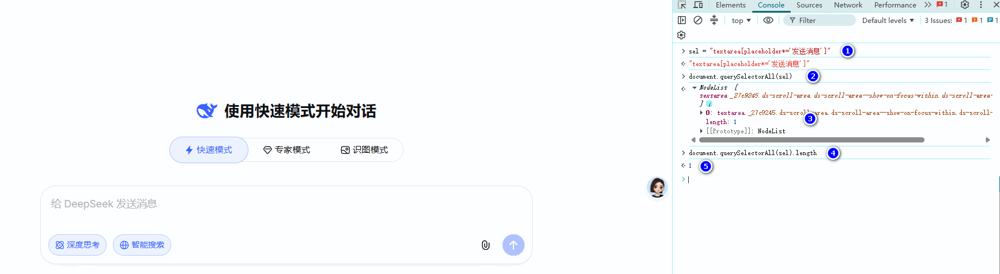
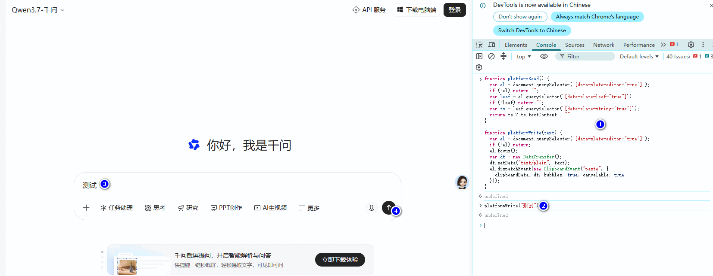
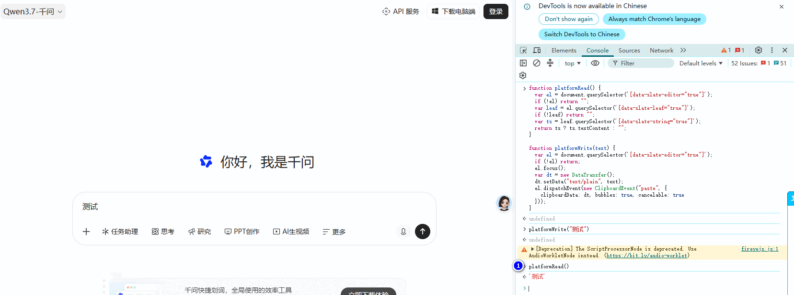

# AGENTS.md 对话导入器

一个无需构建的 Chrome/Edge Manifest V3 扩展，用于管理多条 `AGENTS.md` 或文本规范，并把指定内容写入网页大模型的聊天输入框。

首次安装会添加以下默认网站配置：

- `https://chat.deepseek.com/*`
- `https://www.doubao.com/*`
- `https://www.qianwen.com/*`
- `https://chatgpt.com/*`

默认网站可以编辑或删除。也可以在设置页添加其他 HTTP/HTTPS 大模型网站，并配置聊天输入框选择器。

扩展只负责写入输入框，**不会自动点击发送**。

## 安装

1. 打开 Chrome 的 `chrome://extensions/` 或 Edge 的 `edge://extensions/`。
2. 开启“开发者模式”，点击“加载已解压的扩展程序”。
3. 选择包含 `manifest.json` 的仓库根目录。
4. 建议把扩展固定到浏览器工具栏。

扩展更新后，需要在扩展管理页面重新加载扩展，并刷新已经打开的目标网站。

## 配置管理

点击扩展弹窗右上角的设置按钮，或在扩展详情页中打开“扩展程序选项”。设置页支持：

- 添加一个或多个 `.md`、`.txt` 文件。
- 直接创建和编辑文本规范。
- 为每条配置设置名称、启用状态、顺序和适用网站。
- 为每条配置设置独立的开头标记和结尾标记；留空时恢复默认标记。
- 选择插入输入框首行或末尾。
- 录制页面快捷键，例如 `Ctrl+Shift+1`。
- 导入或导出完整 JSON 配置。

“网站管理”支持添加、编辑、复制和删除网站，配置多条有优先级的 CSS 选择器，开启通用输入框自动识别，并在已打开的目标网站中测试和高亮匹配元素。DeepSeek、豆包、千问和 ChatGPT 的只读参考模板会永久保留，删除默认网站后仍可从模板重新添加。

文件配置会优先读取磁盘最新正文，并保留一份未编辑的来源快照。文件被移动、删除、权限失效或配置来自 JSON 时，“重新读取”会恢复来源快照；也可以在设置页关联本地文件以重新读取磁盘最新内容。

## 插入配置

打开任意已添加且已授权的网站后，点击扩展图标：

1. 弹窗只显示已启用且适用于当前网站的配置。
2. 点击某条配置右侧的“插入”可以单独写入。
3. 点击“全部插入”会按设置页顺序写入当前网站全部有效配置。

新安装默认可以使用原生扩展快捷键 `Ctrl+I` 执行“全部插入”。浏览器若没有采用该快捷键，可在以下页面修改：

- Chrome：`chrome://extensions/shortcuts`
- Edge：`edge://extensions/shortcuts`

每条配置的动态快捷键由扩展设置页录制，只在受支持的聊天页面获得焦点时生效。快捷键至少需要包含 `Ctrl`、`Alt` 或 `Meta`，并且不能与适用网站范围重叠的其他配置或浏览器扩展命令冲突。部分浏览器或操作系统保留快捷键不会传递给网页，需要改用其他组合键。

## 插入和替换规则

每条配置都有独立 UUID 标记。第一次触发会根据配置写入输入框首部或末尾，并用空行与原有草稿分隔。

再次触发同一条配置时，扩展会替换旧内容并按照当前插入位置重新定位，不会重复叠加，也不会修改其他配置块。执行“全部插入”时，首部和末尾配置都会保持设置页中的顺序。

旧版的“全局规范”会自动迁移为适用于全部网站的文件配置；网站专属规范会迁移为对应网站的配置。旧 IndexedDB 记录会保留，迁移标记可避免重复创建条目。

## JSON 备份

导出的 JSON 使用固定格式：

```json
{
  "format": "agent-prompt-webchat-loader",
  "schemaVersion": 3,
  "exportedAt": "2026-07-22 15:30:45",
  "profiles": [
    {
      "content": "使用中文。",
      "createdAt": "2026-07-22 15:20:00",
      "enabled": true,
      "endMarker": "<<<请你严格遵循给定的规范:END>>>",
      "fileName": "",
      "id": "11111111-1111-4111-8111-111111111111",
      "name": "通用规范",
      "order": 0,
      "placement": "prepend",
      "shortcut": null,
      "sites": ["*"],
      "sourceType": "text",
      "startMarker": "<<<请你严格遵循给定的规范:START>>>",
      "updatedAt": "2026-07-22 15:30:00"
    }
  ],
  "sites": [
    {
      "autoDetect": true,
      "createdAt": "2026-07-22 15:20:00",
      "editorSelectors": ["#prompt-textarea[contenteditable='true']"],
      "id": "10000000-0000-4000-8000-000000000004",
      "name": "ChatGPT",
      "origin": "https://chatgpt.com",
      "updatedAt": "2026-07-22 15:30:00"
    }
  ]
}
```

JSON 格式分为两个顶层数组：`profiles`（规范配置）和 `sites`（网站适配）。

`profiles` 数组的每个对象包含：

| 字段 | 类型 | 必填 | 说明 |
|---|---|---|---|
| `id` | string | 是 | 配置唯一 UUID，用于替换和去重 |
| `name` | string | 是 | 显示名称 |
| `content` | string | 是 | 规范正文 |
| `enabled` | boolean | 是 | 是否启用 |
| `sourceType` | `"text"` / `"file"` | 是 | 文本配置或文件配置 |
| `placement` | `"prepend"` / `"append"` | 是 | 插入输入框首行或末尾 |
| `startMarker` | string | 是 | 开头标记，留空时使用默认标记 |
| `endMarker` | string | 是 | 结尾标记，不能与开头标记相同 |
| `sites` | string[] | 是 | 适用网站 ID 列表；`["*"]` 表示全部网站 |
| `shortcut` | object / null | 否 | 动态快捷键，录制得到的组合键对象 |
| `createdAt` | string | 是 | 创建时间，格式 `YYYY-MM-DD HH:mm:ss` |
| `updatedAt` | string | 是 | 更新时间，同上 |
| `fileName` | string | 文件配置 | 来源文件名，`sourceType: "file"` 时存在 |
| `sourceContent` | string | 文件配置 | 来源文件快照，`sourceType: "file"` 时存在 |

`shortcut` 对象固定包含 `altKey`、`code`、`ctrlKey`、`metaKey`、`shiftKey` 五个布尔值或字符串字段，`code` 是按键的 `event.code` 值。

`sites` 数组的每个对象包含：

| 字段 | 类型 | 必填 | 说明 |
|---|---|---|---|
| `id` | string | 是 | 网站唯一 UUID，被 `profiles[].sites` 引用 |
| `name` | string | 是 | 网站显示名称 |
| `origin` | string | 是 | 网站地址，只支持 HTTP/HTTPS，统一为 `origin` 格式 |
| `autoDetect` | boolean | 是 | 选择器未命中时是否回退到通用自动识别 |
| `editorSelectors` | string[] | 选择器模式 | 输入框 CSS 选择器列表，按优先级从上到下排列 |
| `code` | string | JS 模式 | 自定义 JS 代码，包含 `platformRead` / `platformWrite` 两个函数 |
| `createdAt` | string | 是 | 创建时间，格式同上 |
| `updatedAt` | string | 是 | 更新时间，同上 |

网站必须至少提供一条 `editorSelectors`，或开启 `autoDetect`，或提供 `code`，否则校验失败。

备份包含规范配置以及实际使用的网站名称、origin、选择器（或自定义代码）和自动识别状态。只读参考模板不重复写入备份。浏览器文件句柄、网站授权状态、最后导入记录及任何聊天内容不会导出。

`exportedAt`、`createdAt` 和 `updatedAt` 均使用浏览器本地时间，格式固定为 `YYYY-MM-DD HH:mm:ss`，字符串不携带时区偏移量。备份格式当前为 `schemaVersion: 3`，并兼容导入 `schemaVersion: 2` 的旧版 JSON。

导入时会先完整校验版本、配置及网站 ID、标记、时间、网站引用、选择器、插入位置和快捷键冲突。校验通过并确认后才会整体替换现有配置；解析或校验失败不会修改已有数据。导入的自定义网站需要在网站管理中主动授权。

## 隐私说明

- 配置正文和文件句柄保存在扩展专属 IndexedDB 中。
- 动态快捷键索引保存在 `chrome.storage.local` 中，不包含规范正文。
- 扩展不会把配置上传到外部服务器。
- 只有用户点击按钮或触发快捷键时，扩展才会写入当前聊天输入框。
- 扩展不会自动发送消息。

当用户手动发送后，输入框内容将按照目标网站自身的隐私政策发送给对应服务商。

## 项目结构

```text
assets/icons/ 扩展图标
background/   配置读取、文件刷新和导入编排
content/      网站编辑器探测、动态快捷键和文本写入
lib/          配置模型、IndexedDB 存储和内容块合并
options/      独立配置管理页
popup/        当前网站快速插入弹窗
tests/        无第三方依赖的确定性 Node.js 测试
manifest.json Manifest V3 配置
```

## 站点适配

普通网站可以直接在设置页添加，无需修改扩展代码。每个网站的适配有两种方式：

- **CSS 选择器**：适合大多数 `textarea` 或 `contenteditable` 输入框。填写多条有优先级的选择器，并可在设置页直接"测试选择器"高亮匹配元素。
- **自定义 JS 代码**：用于 CSS 选择器无法可靠读取或写入的编辑器（例如千问的 Slate 编辑器），需要提供 `platformRead` / `platformWrite` 两个函数。在网页大模型的浏览器开发者工具控制台（F12）中`console`调用 `platformWrite("text")`，预期效果：页面输入框自动填入“text”，且“发送”按钮的 UI 状态发生相应变化。随后调用 `platformRead()`，应能正确读取此前由 `platformWrite` 写入的内容。

两种方式任选其一；选择器方式还可以开启"通用输入框自动识别"作为兜底。

### 内置网站模板

扩展首次安装会创建以下 4 个只读参考模板（删除后仍可从设置页重新添加）：

| 网站 | 地址 | 自动识别 | 适配方式 |
|---|---|---|---|
| DeepSeek | `https://chat.deepseek.com` | 开启 | CSS 选择器 |
| 豆包 | `https://www.doubao.com` | 开启 | CSS 选择器 |
| 千问 | `https://www.qianwen.com` | 开启 | JS 代码 |
| ChatGPT | `https://chatgpt.com` | 开启 | CSS 选择器 |

各网站的完整选择器列表见 `lib/site-model.js` 中的 `DEFAULT_SITE_TEMPLATES`。维护参考模板时，只修改该集中模板数据；模板更新不会覆盖用户已保存的网站配置。当前实现不能直接访问跨域 iframe 或封闭 Shadow DOM 内的编辑器。

### CSS 选择器编写指南

扩展按列表顺序依次尝试每条选择器，**遇到恰好匹配一个可见且可编辑的元素就立即使用**，因此应把最稳定、最有把握的选择器放在前面。

以 DeepSeek 为例，内置选择器如下：

```text
textarea#chat-input
textarea[placeholder*='DeepSeek']
textarea[placeholder*='发送消息']
[contenteditable='true'][data-lexical-editor='true']
[contenteditable='true'][role='textbox']
```

逐条说明：

| 选择器 | 匹配思路 |
|---|---|
| `textarea#chat-input` | 页面为输入框提供了稳定唯一的 ID，优先使用，最简单可靠 |
| `textarea[placeholder*='DeepSeek']` | 用 `placeholder` 文本模糊匹配网站英文关键词，`*=` 表示包含 |
| `textarea[placeholder*='发送消息']` | 匹配中文 placeholder，用于页面文案变化时兜底 |
| `[contenteditable='true'][data-lexical-editor='true']` | 富文本编辑器的特征属性（Lexical 框架），CSS 选择器可组合多个属性条件 |
| `[contenteditable='true'][role='textbox']` | 同时满足可编辑和无障碍角色的通用规则，常作为最后兜底 |

编写步骤：

1. 打开目标网站，按 `F12` 打开开发者工具，在 Elements 面板点击"选择元素"图标，点选聊天输入框。
2. 查看该元素的标签、`id`、`class`、`placeholder`、`contenteditable`、`role`、`data-*` 属性。
3. 优先使用带 `id` 或稳定 `data-*` 属性的选择器；没有稳定属性时，用 `textarea[placeholder*='关键词']` 这类属性文本匹配。
4. 不要使用类名中包含框架随机串（如 `css-1x8d7n4`）的选择器，页面改版后容易失效。
5. 每条选择器在设置页独占一行，保存后点击"测试选择器"，确认**恰好匹配 1 个可见元素**，扩展会短暂高亮该输入框。
6. 若某条选择器匹配 0 个或多个元素，扩展会自动跳到下一条继续尝试；全部失败则提示"没有找到唯一可用的聊天输入框"。

注意事项：

- 选择器必须只匹配一个可见编辑器。匹配到多个元素（例如隐藏的草稿编辑区）时不会被采用。
- 聊天页面的输入框通常是动态生成的，改版后属性可能变化；必要时保留"通用输入框自动识别"作为回退。

### 自定义 JS 代码（platformRead / platformWrite）

某些编辑器并不把真实内容放在可见 DOM 文本中（例如千问基于 Slate 框架的编辑器），用选择器能找到输入框，却读不到、写不进有效内容。此时可在网站管理中切换到"JS 代码"模式。

代码必须定义两个全局函数：

| 函数 | 参数 | 返回值 | 作用 |
|---|---|---|---|
| `platformRead()` | 无 | 字符串 | 返回输入框当前的完整文本内容 |
| `platformWrite(text)` | `text`：合并后的文本 | 无 | 把文本写入输入框，并触发页面事件让网页感知内容变化 |

扩展先调用 `platformRead()` 读取当前草稿，把要插入的配置块合并进去，再调用 `platformWrite()` 写回，因此两个函数必须配套实现。

以千问（Qwen）为例，完整代码如下：

```javascript
function platformRead() {
  var el = document.querySelector('[data-slate-editor="true"]');
  if (!el) return "";
  var leaf = el.querySelector('[data-slate-leaf="true"]');
  if (!leaf) return "";
  var ts = leaf.querySelector('[data-slate-string="true"]');
  return ts ? ts.textContent : "";
}

function platformWrite(text) {
  var el = document.querySelector('[data-slate-editor="true"]');
  if (!el) return;
  el.focus();
  var dt = new DataTransfer();
  dt.setData("text/plain", text);
  el.dispatchEvent(new ClipboardEvent("paste", {
    clipboardData: dt, bubbles: true, cancelable: true
  }));
}
```

说明：

- 千问把可见文本放在 `[data-slate-string="true"]` 节点里，`platformRead()` 沿 `data-slate-editor → data-slate-leaf → data-slate-string` 逐层定位文本。
- 直接设置 `textContent` 无法让 Slate 更新内部状态，`platformWrite()` 改为模拟一次"粘贴"：通过 `DataTransfer` 携带文本并派发 `ClipboardEvent('paste')`，让框架按正常输入流程处理。
- 代码在页面的 `MAIN` 世界执行，可访问页面自身的全局对象和框架内部 API。设置页的"测试代码"会调用 `platformRead()` 并显示返回值。
- 代码应保持小而独立，只依赖 `document` 和 DOM API，不要引用扩展注入的其他变量。


#### 步骤
一、测试选择器是否可以唯一获取输入框对象


二、定义platformRead和platformWrite函数


三、执行platformRead和platformWrite函数


## 开发检查

项目没有构建步骤和第三方依赖。运行确定性测试：

```powershell
node tests/instruction-block.test.js
node tests/site-model.test.js
node tests/profile-model.test.js
node tests/profile-store.test.js
```

浏览器改动需要在 DeepSeek、豆包、千问、ChatGPT 和至少一个自定义网站中人工检查：权限申请、选择器测试、文件刷新与缓存回退、文本配置、单条和全部插入、首尾位置、重复替换、页面快捷键、原生 `Ctrl+I` 以及 JSON 导入导出。每次检查都应确认扩展不会自动发送消息。
